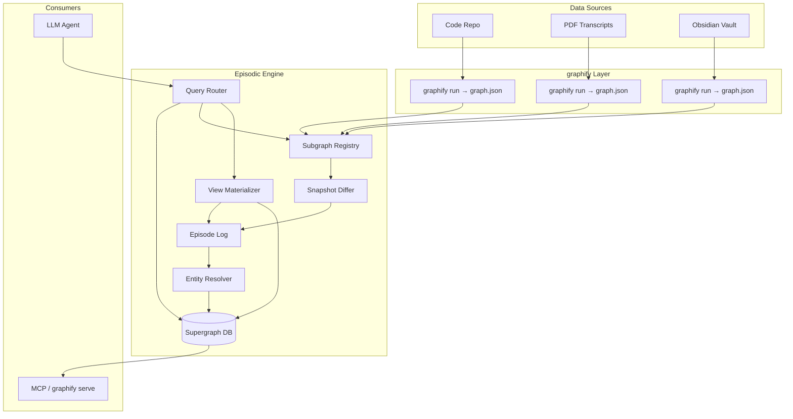

# 00 — System Overview

## Problem Statement

Graphify produces **isolated, static** knowledge graphs — one `graph.json` per corpus (code repo, PDF folder, Obsidian vault). Each graph is excellent for structural navigation within that source, but:

- Sources don't know about each other ("User Auth" in docs ≠ `auth.py` in code unless manually linked)
- Regeneration **overwrites** prior state — no episodic history
- LLM queries can't distinguish "current auth code" from "auth spec from last month"

**Episodic Engine** is the synthesis and memory layer that:

1. Registers multiple graphify outputs as **subgraphs**
2. Resolves duplicate entities into a unified **Supergraph**
3. Appends changes as **episodes** (never destructive overwrite of history)
4. Routes natural-language queries to the right scope (local subgraph vs global Supergraph)
5. Supports **time-travel** queries ("what did we believe last Tuesday?")

---

## Glossary

| Term | Definition |
|------|------------|
| **Subgraph** | A single graphify output (`graph.json`) bound to one data source and one ingestion run |
| **Supergraph** | The unified, queryable global memory graph spanning all subgraphs |
| **Episode** | An append-only record of changes derived from a subgraph regeneration or manual merge |
| **Assertion** | A time-bounded claim that a node or edge exists (or existed) with given properties |
| **Global ID** | Stable identifier for a canonical entity in the Supergraph, surviving across subgraph versions |
| **Local ID** | Node/edge ID as emitted by graphify within a specific subgraph snapshot |
| **Entity Resolution** | Process of deciding two local nodes refer to the same real-world concept |
| **Materialized View** | A graph snapshot computed by applying episodes up to a point in time |

---

## Design Principles

### 1. Git for Graphs, Not Graph Copies

Store **deltas** (operations), not full graph snapshots per episode. Raw graphify outputs are immutable blobs referenced by hash — identical to Git storing tree objects.

### 2. Append-Only Episodic Memory

Never delete history. Retract edges/nodes by closing their validity window (`valid_to`), not by removing rows.

### 3. Separation of Concerns

| Layer | Responsibility |
|-------|------------------|
| **graphify** | Extraction (AST + semantic), per-source graph generation |
| **Subgraph Store** | Immutable snapshots + metadata |
| **Episode Log** | Append-only change journal |
| **Supergraph DB** | Canonical entities, cross-graph edges, fast traversal |
| **Query Router** | Intent classification + scope selection |
| **Materializer** | Point-in-time view construction (optional cache) |

### 4. Deterministic Before Probabilistic

Entity resolution uses cheap, reproducible signals (paths, FQNs, exact aliases) before embeddings or LLM calls. Probabilistic merges require confidence scores and can be marked `tentative` (graphify already uses this pattern in work memory).

### 5. LLM-Facing, Not LLM-Dependent

Core ingestion, diffing, and routing must work offline. LLMs assist semantic extraction (already in graphify) and ambiguous merge adjudication — not the storage model itself.

---

## High-Level Architecture

---

## What graphify Already Provides (Don't Rebuild)

See [08-graphify-integration.md](./08-graphify-integration.md) for detail. Highlights:

- AST extraction, semantic doc extraction, `graph.json` format
- `graphify global add` — merges project graphs into `~/.graphify/global-graph.json`
- Git hook with union-merge on `graph.json` conflicts
- Query CLI: `graphify query`, `graphify path`, `graphify explain`
- MCP server: `query_graph`, `get_node`, `get_neighbors`, `shortest_path`
- Work memory overlay: `.graphify_learning.json` with `preferred/tentative/contested` tags

Episodic Engine **extends** this with cross-source resolution, episode history, and time-travel — it should not replace graphify's extraction pipeline.

---

## Success Criteria

| Criteria | Measure |
|----------|---------|
| Cross-source linking | "Auth spec PDF" node resolves to `auth.py` module with traceable provenance |
| Temporal fidelity | Query at T returns only assertions valid at T ± configurable slack |
| No bloat explosion | Episode storage grows with **changes**, not total node count × episodes |
| Query latency | Supergraph path query < 500ms for graphs up to ~500K nodes (with indexes) |
| Regeneration safety | Re-running graphify on unchanged source produces zero new episode ops |
