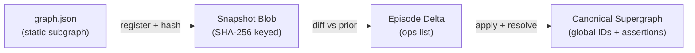
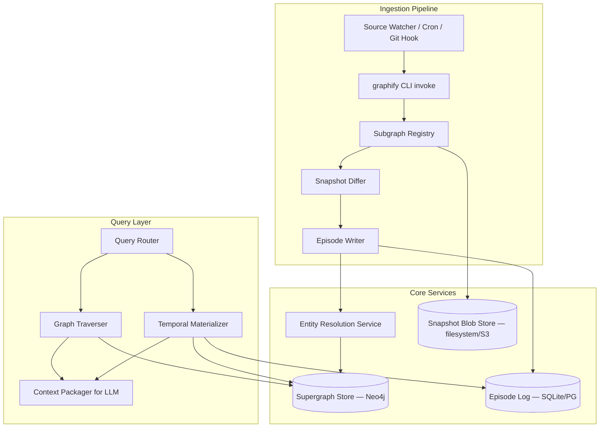
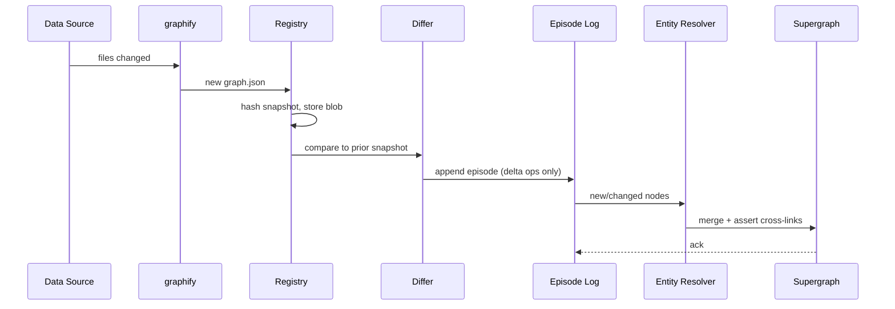
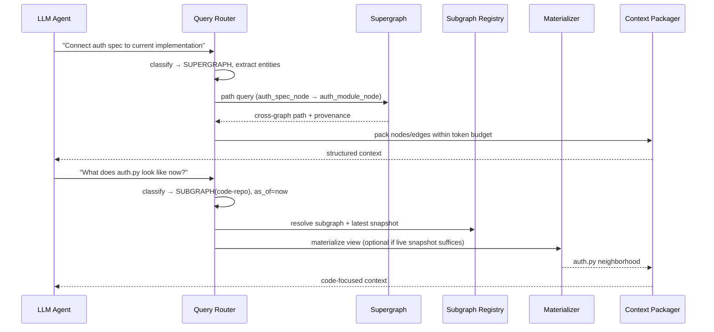

# 01 — Architecture Overview

Engineering view of the **context compiler** described in [episodic-grand-plan.md](./episodic-grand-plan.md): graphify produces per-corpus graphs; Episodic registers snapshots, records episodes, resolves entities into a Supergraph, and (Phase 2+) routes harness queries to bounded, evidence-first context packs.

## Bridging graphify's Flat JSON to a Dynamic Supergraph

Graphify's `graph.json` is a **serialized NetworkX graph**: nodes (entities, files, functions, concepts) and edges (AST relationships, semantic links, doc references). It is:

- **Self-contained** — all IDs are local to that extraction run
- **Overwrite-oriented** — regeneration replaces the file (with optional union-merge via git hook)
- **Single-corpus** — `global add` merges multiple projects but has no temporal model

Episodic Engine inserts three transformations between graphify output and LLM queries:

### Transformation 1: Snapshot Registration

Every graphify run produces a **Subgraph Snapshot**:

- Store raw `graph.json` content-addressed (`sha256:abc...`)
- Attach metadata: source URI, graphify version, extraction timestamp, optional git commit hash
- Map local node/edge IDs → `(subgraph_id, snapshot_hash, local_id)` tuple

The snapshot is **immutable**. Regeneration creates a new snapshot; the old one remains addressable.

### Transformation 2: Delta Extraction

Compare new snapshot to the previous snapshot **for the same subgraph_id**:

| Change Type | Episode Operation |
|-------------|-------------------|
| New local node | `ASSERT_NODE` |
| Removed local node | `RETRACT_NODE` (set `valid_to`) |
| Changed node properties | `UPDATE_NODE` (close old assertion, open new) |
| New local edge | `ASSERT_EDGE` |
| Removed local edge | `RETRACT_EDGE` |
| Unchanged | *(no op — critical for bloat control)* |

Use stable **local fingerprints** where graphify re-issues IDs on rebuild:

- Code: `(type, file_path, qualified_name)` or graphify's existing canonical keys (e.g., package name hubs)
- Docs: `(type, file_path, heading_path)` or wikilink target
- Concepts: `(type, normalized_label, source_span_hash)`

### Transformation 3: Supergraph Synthesis

Apply episode operations to the Supergraph:

1. **Upsert canonical node** (create `global_id` if new fingerprint)
2. **Run entity resolution** against existing Supergraph nodes (see [03-entity-resolution.md](./03-entity-resolution.md))
3. **Create cross-graph edges** when resolution links a doc concept to a code symbol
4. **Record assertions** with temporal metadata (see [02-temporal-schema-design.md](./02-temporal-schema-design.md))

---

## Component Architecture

### Component Responsibilities

| Component | Input | Output | Notes |
|-----------|-------|--------|-------|
| **Subgraph Registry** | `graph.json` path + source config | `subgraph_id`, snapshot record | One registry entry per logical source (e.g., `myrepo-code`) |
| **Snapshot Differ** | Two consecutive snapshots | List of delta operations | Must be deterministic |
| **Episode Writer** | Delta ops + metadata | Episode record in log | Append-only; assigns monotonic `episode_id` |
| **Entity Resolver** | New/changed nodes + Supergraph index | Merge decisions, cross-edges | Tiered: deterministic → embedding → LLM |
| **Supergraph Store** | Canonical entities + active assertions | Traversal query results | Neo4j recommended ([05](./05-storage-and-database-decision.md)) |
| **Query Router** | Natural language query | `{scope, subgraph_ids?, as_of?}` | See [04](./04-query-routing-engine.md) |
| **Temporal Materializer** | `as_of` timestamp + scope | Subgraph view | Applies episode log backwards/forwards |
| **Context Packager** | Traversal result | Token-budgeted context string | Reuses graphify's subgraph extraction patterns |

---

## Data Flow: Subgraph Regeneration

---

## Data Flow: LLM Query

---

## Interface with graphify Query CLI

Episodic Engine should expose a compatible surface:

| graphify today | Episodic Engine equivalent |
|----------------|---------------------------|
| `graphify query "..." --graph path` | `episodic query "..." --subgraph code-repo` |
| `graphify path A B --graph path` | `episodic path A B --scope supergraph` |
| `graphify global query "..."` | `episodic query "..." --scope supergraph` |
| MCP `query_graph` | MCP `query_episodic_graph` with `as_of` parameter |

Implementation strategy: **delegate to graphify's query engine for single-subgraph, current-state queries**; use Neo4j + materializer for supergraph and temporal queries.

---

## Three Architecture Approaches Considered

### Approach A: File-Only + NetworkX (Minimal)

- Episodes stored as JSONL; Supergraph rebuilt in memory on startup
- **Pros:** Zero infra, aligns with graphify's NetworkX roots
- **Cons:** Slow supergraph queries, poor time-travel at scale, no concurrent access
- **Verdict:** Good for prototype only

### Approach B: Neo4j Supergraph + SQLite Episode Log (Recommended)

- Immutable snapshots on disk; episodes in SQLite; canonical graph in Neo4j
- **Pros:** Fast traversal, native relationship indexing, Cypher for temporal filters, clear separation
- **Cons:** Neo4j deployment (can use Neo4j Desktop / Docker for dev)
- **Verdict:** **Recommended** for production LLM memory

### Approach C: PostgreSQL + pgvector + Recursive CTEs

- Single database for episodes, entities, embeddings, and graph edges
- **Pros:** One ops stack, strong ACID, good for entity resolution embeddings
- **Cons:** Graph traversal queries become complex and slower than native graph DB
- **Verdict:** Strong alternative if team already runs Postgres and graph size < ~100K edges

**Recommendation:** Approach B for Supergraph traversal; optionally use Postgres/pgvector as embedding store for entity resolution even if Neo4j holds the graph.

---

## Error Handling & Edge Cases

| Scenario | Behavior |
|----------|----------|
| graphify produces fewer nodes (refactor deleted files) | Diff emits `RETRACT_*` ops; history preserved |
| Same entity, new local ID after refactor | Fingerprint match links to same `global_id`; old local ID mapping archived |
| Conflicting merge (two functions, same name, different files) | Keep separate `global_id`s; mark `contested` link proposal |
| graphify ghost duplicates (known graphify issue) | `--force` rebuild + dedup pass before diffing |
| Partial source failure (PDF extraction empty) | Episode with `status: partial`; don't retract prior assertions |
| Clock skew / backdated commits | Use **ingestion time** for episode ordering; store `source_timestamp` separately |

---

## Testing Strategy (Planning Only)

| Test Type | What It Validates |
|-----------|-------------------|
| **Snapshot diff golden tests** | Known graph A → B produces expected op list |
| **Resolution fixtures** | Doc "User Auth" + code `auth.py` merge correctly |
| **Temporal replay** | Apply episodes 1..N, materialized view matches expected |
| **Idempotency** | Re-ingesting identical snapshot produces zero ops |
| **Router classification** | NL queries map to correct scope (benchmark set) |
