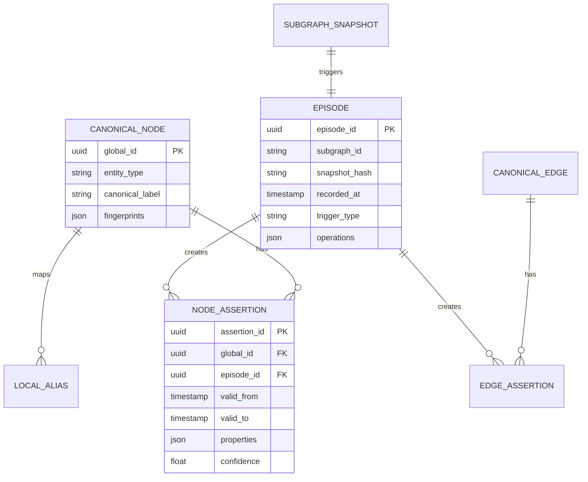

# 02 — Temporal Schema Design

## Goal

Store episodic versioning **without exponential bloat**. The anti-pattern is copying the entire Supergraph on every graphify regeneration. The correct model mirrors Git: **content-addressed snapshots + append-only delta log + validity windows on assertions**.

---

## Core Concept: Assertions, Not Mutable Nodes

A node or edge in the Supergraph is not a single mutable record. It is a **canonical identity** (`global_id`) plus a series of **assertions** — time-bounded claims about properties and existence.



When `valid_to IS NULL`, the assertion is **currently active** (for the latest materialized view).

---

## Episode Record Schema

Episodes are the **unit of history** — one episode per subgraph ingestion event (or manual merge).

```json
{
  "episode_id": "ep_000042",
  "sequence": 42,
  "recorded_at": "2026-07-06T12:00:00Z",
  "subgraph_id": "myrepo-code",
  "snapshot": {
    "hash": "sha256:a1b2c3...",
    "graphify_version": "0.9.2",
    "node_count": 1842,
    "edge_count": 5103
  },
  "source_provenance": {
    "type": "git",
    "commit": "abc123def",
    "branch": "main",
    "source_path": "/data/myrepo"
  },
  "trigger": {
    "type": "graphify_regen",
    "mode": "ast_only | full_semantic"
  },
  "parent_episode_id": "ep_000041",
  "stats": {
    "ops_total": 37,
    "nodes_added": 12,
    "nodes_retracted": 3,
    "edges_added": 18,
    "edges_retracted": 4,
    "merges": 2
  },
  "operations": [
    {
      "op": "ASSERT_NODE",
      "global_id": "gn_8f3a...",
      "local_ref": {
        "subgraph_id": "myrepo-code",
        "local_id": "node_1847",
        "fingerprint": "function:src/auth.py:authenticate_user"
      },
      "properties": {
        "label": "authenticate_user",
        "type": "function",
        "file": "src/auth.py",
        "docstring": "Validate credentials and issue JWT."
      },
      "confidence": 1.0
    },
    {
      "op": "RETRACT_EDGE",
      "global_id": "ge_991b...",
      "valid_to": "2026-07-06T12:00:00Z",
      "reason": "removed_in_snapshot_diff"
    },
    {
      "op": "MERGE_ENTITIES",
      "survivor_global_id": "gn_auth_module",
      "merged_global_id": "gn_temp_004",
      "confidence": 0.94,
      "method": "embedding+path_context"
    }
  ]
}
```

### Operation Types (Closed Set)

| Operation | Effect |
|-----------|--------|
| `ASSERT_NODE` | Open new node assertion (`valid_from = episode.recorded_at`) |
| `UPDATE_NODE` | Close prior assertion; open new with changed properties |
| `RETRACT_NODE` | Set `valid_to` on active assertion |
| `ASSERT_EDGE` | Open new edge assertion |
| `RETRACT_EDGE` | Set `valid_to` on active edge assertion |
| `MERGE_ENTITIES` | Redirect aliases; close duplicate; preserve both histories |
| `SPLIT_ENTITY` | Reverse a bad merge (manual correction episode) |
| `RESOLVE_CROSS_LINK` | Create Supergraph-only edge with cross-subgraph provenance |

**Bloat control rule:** Operations array contains **only changes**. A regeneration with zero diffs produces an episode with `"operations": []` and `"stats.ops_total": 0` — or skip episode creation entirely.

---

## Canonical Node Schema (Supergraph)

```json
{
  "global_id": "gn_auth_module",
  "entity_type": "module",
  "canonical_label": "auth",
  "fingerprints": [
    "module:src/auth.py",
    "concept:User Authentication"
  ],
  "aliases": [
    {
      "subgraph_id": "myrepo-code",
      "local_id": "node_442",
      "snapshot_hash": "sha256:a1b2...",
      "label": "auth.py"
    },
    {
      "subgraph_id": "product-docs",
      "local_id": "node_89",
      "snapshot_hash": "sha256:d4e5...",
      "label": "User Auth"
    }
  ],
  "created_episode_id": "ep_000001",
  "resolution_status": "confirmed | tentative | contested"
}
```

Node **properties** (label, docstring, file path, etc.) live on assertions, not the canonical record — so property history is preserved.

---

## Canonical Edge Schema (Supergraph)

```json
{
  "global_id": "ge_spec_implements",
  "relationship": "IMPLEMENTS",
  "source_global_id": "gn_auth_spec_section",
  "target_global_id": "gn_auth_module",
  "assertions": [
    {
      "assertion_id": "ea_000120",
      "episode_id": "ep_000015",
      "valid_from": "2026-06-15T09:00:00Z",
      "valid_to": null,
      "confidence": 0.91,
      "provenance": {
        "origin": "entity_resolution",
        "method": "llm_adjudicated",
        "subgraph_evidence": [
          {"subgraph_id": "product-docs", "local_edge_id": "e_201"},
          {"subgraph_id": "myrepo-code", "local_edge_id": "e_88"}
        ]
      },
      "properties": {
        "note": "Spec section 3.2 maps to auth module"
      }
    }
  ]
}
```

### Relationship Types

| Relationship | Meaning | Typical Source |
|--------------|---------|----------------|
| `CALLS`, `IMPORTS`, `INHERITS` | AST-derived | Code subgraph |
| `REFERENCES`, `DOCUMENTS` | Doc links | Docs subgraph |
| `IMPLEMENTS` | Cross-graph | Entity resolution |
| `SUPERSEDES` | Temporal replacement | Episode diff |
| `SAME_AS` | Merge equivalence | Entity resolution |
| `CONTRADICTS` | Conflicting claims | Manual or LLM flag |

---

## Subgraph Snapshot Schema (Registry)

```json
{
  "subgraph_id": "myrepo-code",
  "display_name": "MyRepo Application Code",
  "source": {
    "type": "git_repo",
    "uri": "file:///data/myrepo",
    "default_branch": "main"
  },
  "snapshots": [
    {
      "snapshot_hash": "sha256:a1b2c3...",
      "ingested_at": "2026-07-06T12:00:00Z",
      "episode_id": "ep_000042",
      "blob_path": "snapshots/myrepo-code/a1b2c3.graph.json",
      "node_count": 1842,
      "edge_count": 5103
    }
  ],
  "latest_snapshot_hash": "sha256:a1b2c3...",
  "latest_episode_id": "ep_000042"
}
```

Raw `graph.json` files are stored **once** per unique hash. Identical content across regen = same blob, no new storage.

---

## Bloat Analysis

| Strategy | Storage Growth | Query Cost |
|----------|---------------|------------|
| Full graph copy per episode | O(nodes × episodes) ❌ | O(1) read |
| Delta ops only | O(changes × episodes) ✅ | O(episodes) replay |
| Delta + periodic compaction | O(changes) + occasional snapshot ✅✅ | O(1) read after checkpoint |

### Compaction (Phase 2+)

Every N episodes (or when replay exceeds threshold), materialize a **checkpoint view** and archive prior ops:

```
checkpoint_ep_1000.view → stored as Neo4j snapshot export
episodes 1001+ apply on top of checkpoint
```

This bounds time-travel replay cost without losing history (archived ops remain in cold storage).

---

## Bi-Temporal Model (Optional Enhancement)

For advanced use cases, distinguish two timelines:

| Dimension | Field | Meaning |
|-----------|-------|---------|
| **Valid time** | `valid_from` / `valid_to` | When the fact was true in the real world / source |
| **Transaction time** | `recorded_at` / `retracted_at` | When the system learned about it |

Example: A git commit from last Tuesday (`valid_from = commit time`) ingested today (`recorded_at = now`). LLM asks "what did we know last Tuesday?" → filter by `recorded_at`. LLM asks "what did the code look like last Tuesday?" → filter by `valid_from` using git commit timestamps.

**MVP recommendation:** Use single timeline (`recorded_at` = episode time) + store `source_provenance.commit.timestamp` for valid-time queries on code sources.

---

## Neo4j Property Graph Mapping

| Logical Entity | Neo4j Representation |
|----------------|---------------------|
| Canonical node | `(:Entity {global_id, entity_type, canonical_label})` |
| Active assertion | `(:Entity)-[:HAS_ASSERTION {valid_from, valid_to, ...props}]->(:Assertion)` |
| Or simpler MVP | Properties + `valid_from`/`valid_to` directly on relationship to avoid extra nodes |
| Episode | `(:Episode {episode_id, recorded_at, subgraph_id})` |
| Cross-link | `(:Entity)-[:IMPLEMENTS {assertion_id, valid_from, valid_to, confidence}]->(:Entity)` |

**MVP simplification:** Store only **active** assertions in Neo4j; full assertion history in SQLite episode log. Time-travel replay reads from episode log, not Neo4j.

---

## Index Requirements

| Index | Purpose |
|-------|---------|
| `Entity.global_id` | Primary lookup |
| `Entity.fingerprints` (full-text or array) | Resolution blocking |
| `Episode.recorded_at` | Time-travel cutoff |
| `Episode.subgraph_id` | Subgraph-scoped queries |
| `Assertion.valid_from, valid_to` | Range queries |
| `Alias(subgraph_id, local_id)` | Map graphify local IDs → global |
