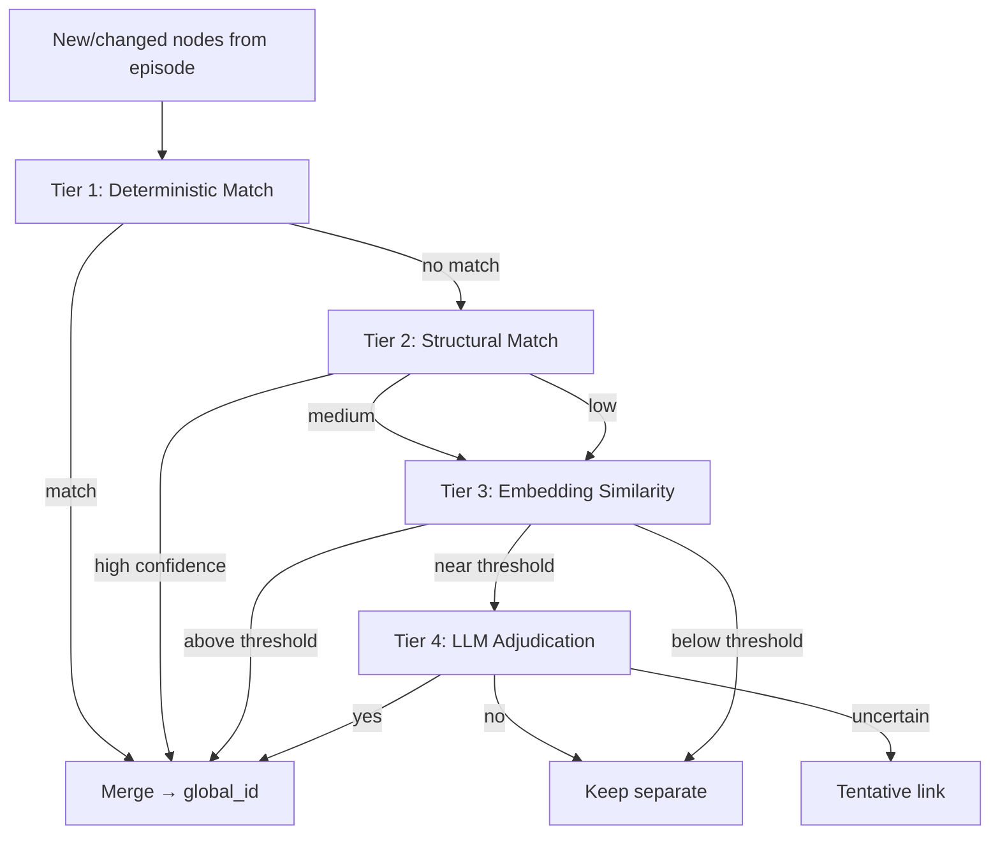

# 03 — Entity Resolution

## Problem

Two graphify subgraphs will refer to the same real-world entity with different local IDs, labels, and sometimes types:

| Subgraph | Local Node | Label | Type |
|----------|------------|-------|------|
| `product-docs` | `node_89` | "User Auth" | concept |
| `myrepo-code` | `node_442` | `auth.py` | module |
| `myrepo-code` | `node_443` | `authenticate_user` | function |

Entity resolution decides whether to **merge** into one canonical Supergraph node (`gn_auth_module`) and create **cross-graph edges** (`IMPLEMENTS`, `DOCUMENTS`, `SAME_AS`).

---

## Resolution Pipeline (Tiered)



Each tier is cheaper than the next. **Never skip Tier 1.**

---

## Tier 1: Deterministic Matching

Highest confidence (1.0). No ML required.

### Match Rules

| Signal | Condition | Example |
|--------|-----------|---------|
| **Exact fingerprint** | Normalized fingerprint string equal | `module:src/auth.py` |
| **File path alias** | Doc wikilink target = code file path | `[[auth.py]]` ↔ `src/auth.py` |
| **Package hub** | graphify already dedupes package nodes by name | `depends_on` targets same package |
| **Qualified symbol** | Same `(file, qualified_name)` across snapshots | Function rename in same file → fingerprint update, not new entity |
| **Explicit registry** | Human-curated `resolution_rules.yaml` | `"User Auth" → module:src/auth.py` |

### Fingerprint Normalization

```
normalize(label):
  lowercase, strip punctuation, collapse whitespace

fingerprint_code(node):
  "{type}:{file_path}:{qualified_name}"

fingerprint_doc(node):
  "{type}:{file_path}:{heading_slug}"
```

Store fingerprints on canonical nodes at first sighting. On subsequent ingest, lookup by fingerprint hash before probabilistic methods.

---

## Tier 2: Structural Matching

Use graph topology within and across subgraphs.

### Signals

| Signal | Weight | Description |
|--------|--------|-------------|
| **Shared neighbor overlap** | High | Doc concept linked to `JWT` also neighbors code `issue_jwt()` |
| **Path coherence** | High | Shortest path in Supergraph already connects 80% of neighbors |
| **Type compatibility** | Medium | `concept` ↔ `module` allowed; `function` ↔ `pdf_page` unlikely |
| **Community cluster** | Medium | graphify community ID overlap (from `GRAPH_REPORT.md` / clustering) |

### Blocking (Performance)

Don't compare all pairs. Build candidate set:

1. Same `entity_type` OR compatible type pair
2. Label similarity > 0.6 (trigram/Jaro-Winkler)
3. At least one shared neighbor label (after Tier 1 partial merge)
4. Same graphify community / Leiden cluster if available

Typical candidate set: O(10–100) per node, not O(N²).

---

## Tier 3: Embedding Similarity

For semantic matches ("User Authentication" ↔ "auth module"):

| Field Embedded | Source |
|----------------|--------|
| Node label + type | graphify node |
| Docstring / summary | AST or LLM extraction |
| Surrounding context | 1-hop neighbor labels concatenated |

- Store embeddings in pgvector, LanceDB, or Neo4j vector index (5.11+)
- Threshold: cosine > **0.85** → auto-merge; **0.75–0.85** → Tier 4; below **0.75** → separate

Embeddings are **recomputed only when node properties change** (assertion update), not on every query.

---

## Tier 4: LLM Adjudication

For borderline pairs (and high-value cross-graph links):

**Prompt structure (conceptual):**

> Given node A (docs concept "User Auth", describes JWT login) and node B (code module `auth.py`, handles JWT issuance), are these the same entity, related entities, or unrelated? Reply: SAME | RELATED | UNRELATED + confidence 0-1 + suggested relationship type.

Results stored as episode ops with `method: llm_adjudicated` provenance. `RELATED` creates typed edge without merge.

**Cost control:** Batch adjudication; cache decisions by `(fingerprint_a, fingerprint_b)` pair hash.

---

## Merge Algorithm (Conceptual Pseudocode)

> Note: Planning pseudocode — not implementation.

```
function merge_subgraphs(subgraph_a, subgraph_b, supergraph, episode_log):

    snapshot_a = load_snapshot(subgraph_a.latest_hash)
    snapshot_b = load_snapshot(subgraph_b.latest_hash)

    episode = new_episode(type="cross_subgraph_sync")

    for node in snapshot_b.nodes:
        candidates = []

        # Tier 1 — deterministic fingerprint match. There is no ALIAS_NODE op type;
        # reuse the existing global_id via ASSERT_NODE with the matched global_id
        # and record the (subgraph_id, local_id) → global_id mapping in local_aliases.
        fp = compute_fingerprint(node)
        match = supergraph.find_by_fingerprint(fp)
        if match:
            episode.add(ASSERT_NODE, global_id=match, local=node, alias_only=True)
            continue

        # Tier 2 blocking
        candidates = supergraph.blocking_search(node, max=50)

        # Tier 3
        for c in candidates:
            c.score = embedding_similarity(node, c)
        best = max(candidates, key=score)

        if best.score > 0.85:
            episode.add(MERGE_ENTITIES, survivor=best.global_id, merged=new(node))
        elif best.score > 0.75:
            decision = llm_adjudicate(node, best)
            apply_decision(decision, episode)
        else:
            global_id = supergraph.create_canonical(node)
            episode.add(ASSERT_NODE, global_id=global_id, local=node)

    for edge in snapshot_b.edges:
        src_global = resolve_local_to_global(edge.source, episode)
        tgt_global = resolve_local_to_global(edge.target, episode)
        if src_global and tgt_global:
            episode.add(ASSERT_EDGE, src=src_global, tgt=tgt_global, type=edge.type)

    # Cross-graph inference pass
    for doc_node in filter_type(snapshot_b, "concept"):
        code_matches = supergraph.find_implementation_candidates(doc_node)
        for cm in code_matches where cm.confidence > threshold:
            episode.add(RESOLVE_CROSS_LINK,
                        src=doc_node.global_id,
                        tgt=cm.global_id,
                        rel=IMPLEMENTS)

    episode_log.append(episode)
    supergraph.apply(episode)
    return episode
```

---

## Cross-Graph Edge Creation

Beyond merging duplicate nodes, the Supergraph adds **synthetic edges** not present in any single subgraph:

| Pattern | Edge | Trigger |
|---------|------|---------|
| Doc mentions file path | `DOCUMENTS` | Regex / wikilink in doc node text |
| Spec requirement → function | `IMPLEMENTS` | LLM or keyword overlap + structural match |
| Test file → module under test | `TESTS` | Path convention (`test_auth.py` → `auth.py`) |
| Obsidian `[[link]]` → code symbol | `REFERENCES` | Vault config maps vault links to repo paths |

Store synthetic edges with `origin: entity_resolution` so they can be retracted independently of source subgraph edges.

---

## Conflict Handling

| Situation | Resolution |
|-----------|------------|
| Transitive merge conflict (A=B, B=C, A≠C) | Union-find with human review queue |
| Split needed after bad merge | `SPLIT_ENTITY` manual episode |
| Two modules, same name, different paths | **Do not merge** — keep separate, disambiguate label |
| graphify ghost duplicates (same file, two nodes) | Pre-ingest dedup using graphify's `--force` + fingerprint collapse |

### Resolution Status Flags

Borrow from graphify work memory:

| Status | Meaning |
|--------|---------|
| `confirmed` | Tier 1 match or human approved |
| `tentative` | Tier 3/4 with confidence < 0.9 |
| `contested` | Conflicting evidence from multiple episodes |

LLM context packager should surface `contested` links explicitly.

---

## Human-in-the-Loop (Phase 2)

`resolution_rules.yaml` overrides:

```yaml
merges:
  - canonical: "gn_auth"
    aliases:
      - subgraph: product-docs
        label_pattern: "User Auth*"
      - subgraph: myrepo-code
        fingerprint: "module:src/auth.py"

never_merge:
  - ["gn_legacy_auth", "gn_auth_v2"]
```

Manual merges emit episodes with `trigger.type: human_override` — fully auditable.

---

## Metrics

| Metric | Target |
|--------|--------|
| Tier 1 hit rate | > 60% of merges (cheap) |
| False merge rate | < 2% (measured by human audit sample) |
| Adjudication calls per ingest | < 50 per subgraph regen |
| Blocking efficiency | < 100 candidates per unresolved node |
