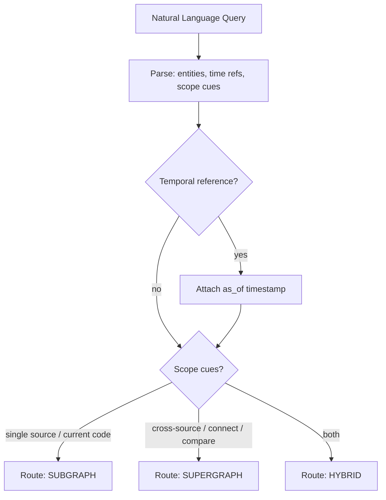
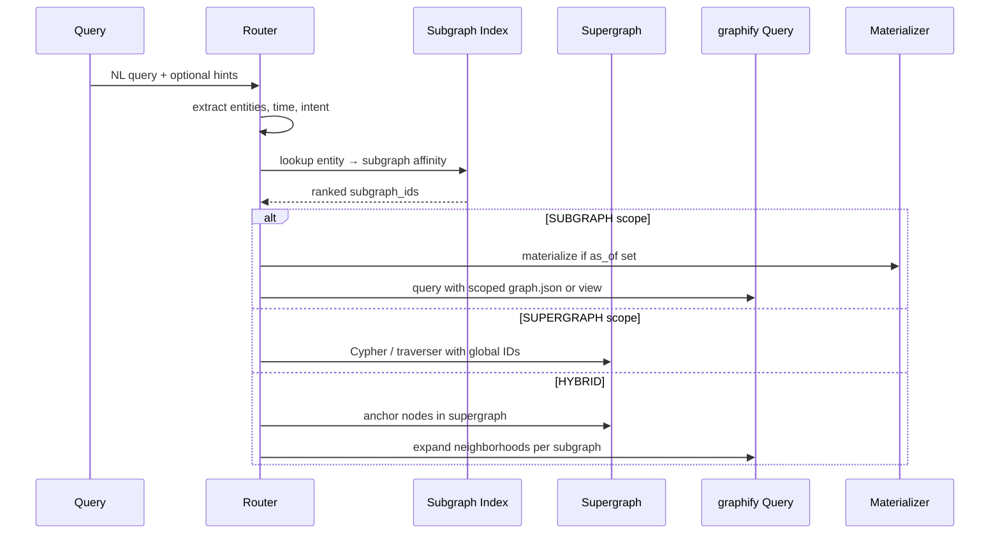
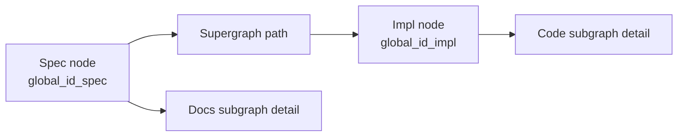

# 04 — Query Routing Engine

> **Grand Plan alignment:** This component evolves into the **unified retrieval core** ([episodic-grand-plan.md](./episodic-grand-plan.md) Phase 2): one interface, pluggable deterministic / embedding / model-guided strategies, shared evidence-first schema, and harness MCP in Phase 4.

## Purpose

Accept a natural-language query and decide:

1. **Scope** — single subgraph vs Supergraph
2. **Target** — which subgraph(s) to query
3. **Temporal mode** — current state vs point-in-time (`as_of`)
4. **Traversal strategy** — neighborhood, path, global search, explain-node

The router sits between the LLM agent and the storage layers. It does **not** answer the question itself — it selects the right graph view and hands off to graphify's query engine or the Supergraph traverser.

---

## Query Classification



### Scope Signal Examples

| Query Pattern                                               | Scope                                | Reason                           |
| ----------------------------------------------------------- | ------------------------------------ | -------------------------------- |
| "What does the current auth code look like?"                | SUBGRAPH (`code-repo`)               | "current code" → code source     |
| "Show me the auth flow in auth.py"                          | SUBGRAPH                             | Explicit file/symbol reference   |
| "Connect the original spec sheet to the implementation"     | SUPERGRAPH                           | Cross-corpus linking             |
| "How did our understanding of JWT change since last month?" | SUPERGRAPH + temporal                | Cross-time + likely cross-source |
| "What did the docs say about auth last Tuesday?"            | SUBGRAPH (`product-docs`) + temporal | Source + time pinned             |
| "Compare spec requirements to test coverage"                | SUPERGRAPH                           | Spans docs + code + tests        |

---

## Routing Pipeline



---

## Router Components

| Component | Responsibility |
|-----------|----------------|
| **Intent Classifier** | Maps query → `{subgraph, supergraph, hybrid}` |
| **Entity Linker** | Resolves mentioned strings to `global_id` or local node candidates |
| **Subgraph Affinity Scorer** | Ranks subgraphs by entity overlap, recency, source type |
| **Temporal Parser** | "last Tuesday", "before the refactor", "at commit abc123" → `as_of` |
| **Traversal Planner** | Chooses query type: `query`, `path`, `explain`, `neighbors` |
| **Context Budget Manager** | Caps tokens returned to LLM (reuse graphify subgraph extraction) |

---

## Intent Classification Approaches

### Approach A: Rule-Based + Keyword Patterns (MVP)

Fast, deterministic, no model cost.

| Rule | Route |
|------|-------|
| Contains file extension (`.py`, `.md`) | Boost subgraph matching that file |
| Contains "connect", "relate", "map spec to", "compare" | SUPERGRAPH |
| Contains "current", "now", "today" + code symbol | SUBGRAPH (code), `as_of=now` |
| Contains date/time expression | Attach temporal, then re-evaluate scope |

**Pros:** Debuggable, zero latency  
**Cons:** Brittle on paraphrases

### Approach B: Small LLM Classifier (Phase 2)

Structured output schema:

```json
{
  "scope": "subgraph | supergraph | hybrid",
  "subgraph_ids": ["myrepo-code"],
  "as_of": "2026-07-01T00:00:00Z | null",
  "traversal": "query | path | explain | neighbors",
  "anchor_entities": ["User Auth", "auth.py"],
  "confidence": 0.92
}
```

**Pros:** Handles nuance  
**Cons:** Cost, latency, needs eval set

### Approach C: Hybrid (Recommended)

1. Rule-based first pass (high-confidence routes skip LLM)
2. LLM classifier only when confidence < 0.8
3. Cache routing decisions by query embedding hash

---

## Subgraph Affinity Scoring

When multiple subgraphs could match, score each:

| Factor | Weight | Description |
|--------|--------|-------------|
| Entity hit | 0.40 | Query entities found in subgraph's node index |
| Type match | 0.20 | Code symbols → code subgraph; doc concepts → docs subgraph |
| Recency | 0.15 | Prefer recently updated subgraph for "current" queries |
| Source hint | 0.15 | User/config specifies default subgraph per domain |
| Past query log | 0.10 | graphify's `~/.cache/graphify-queries.log` patterns |

Pick top subgraph if score > 0.6; otherwise escalate to SUPERGRAPH or ask for clarification.

---

## Traversal Strategy Selection

| Intent | Strategy | Backend |
|--------|----------|---------|
| Open question ("how does auth work?") | `query` — relevance-ranked subgraph | graphify query / vector+structure |
| Two named entities | `path` — shortest path | graphify path / Neo4j shortestPath |
| Single symbol deep dive | `explain` — ego network | graphify explain |
| "What's connected to X?" | `neighbors` — k-hop | MCP get_neighbors |
| Cross-source bridge | `supergraph_path` — cross-graph edges included | Neo4j with `RESOLVE_CROSS_LINK` edges |

---

## Hybrid Query Pattern

For queries like "Does the current code satisfy the original spec?":

1. **Anchor** spec concept in Supergraph → `global_id_spec`
2. **Anchor** implementation module → `global_id_impl`
3. **Path** in Supergraph between anchors (includes synthetic `IMPLEMENTS` edges)
4. **Expand** each hop into subgraph-local detail via graphify `explain`
5. **Package** merged context with provenance tags per subgraph



---

## API Surface (Planning)

### CLI

```bash
# Auto-routed
episodic query "Connect auth spec to implementation"

# Explicit overrides
episodic query "auth flow" --subgraph myrepo-code
episodic query "auth changes" --scope supergraph --as-of "2026-07-01"
episodic path "User Auth" "authenticate_user" --scope supergraph
```

### MCP Tool Extension

Target harness contract ([Grand Plan](./episodic-grand-plan.md) Phase 4): read-only, scope-enforced, budget-aware.

| Tool (target) | Role |
|---------------|------|
| `search_context` | Primary retrieval — replaces ad-hoc `query_episodic_graph` naming |
| `get_node` | Node detail within scope |
| `get_neighbors` | Bounded traversal within scope |

| Tool (extended / legacy) | New Parameters |
|------|----------------|
| `query_episodic_graph` | Alias during migration → `search_context` |
| `search_context` | `scope`, `subgraph_id`, `graph_id`, `as_of`, `strategy`, `token_budget`, `include_contested` |
| `get_entity_history` | `global_id`, `property` |
| `resolve_entity` | `label`, `subgraph_hint` → `global_id` |

---

## Context Packaging for LLM

Output structure (not raw graph dump):

```json
{
  "routing": {
    "scope": "supergraph",
    "as_of": "2026-07-06T12:00:00Z",
    "confidence": 0.91
  },
  "nodes": [
    {
      "global_id": "gn_auth",
      "label": "User Auth",
      "type": "concept",
      "sources": ["product-docs"],
      "resolution_status": "confirmed",
      "summary": "..."
    }
  ],
  "edges": [...],
  "paths": [...],
  "warnings": ["contested merge between gn_auth and gn_auth_legacy"]
}
```

Token budget: prioritize path nodes > 1-hop neighbors > community context (mirror graphify's query response shaping).

---

## Failure Modes

| Situation                           | Router Behavior                                                 |
| ----------------------------------- | --------------------------------------------------------------- |
| No entity matches                   | Return `scope: supergraph`, broad search; suggest subgraph list |
| Ambiguous entity (two auth modules) | Return disambiguation candidates to LLM                         |
| `as_of` before first episode        | Error with earliest available timestamp                         |
| Subgraph stale (> N days)           | Warning in response; suggest regen                              |
| Low routing confidence              | Include `routing.confidence` + alternate scopes                 |

---

## Evaluation Benchmark

Build a fixed set of ~50 queries with expected routing:

| Category | Count | Example |
|----------|-------|---------|
| Subgraph-local | 15 | "What calls authenticate_user?" |
| Supergraph cross | 15 | "Link spec section 3.2 to code" |
| Temporal | 10 | "Auth docs as of June 1" |
| Hybrid | 10 | "Does code match spec?" |

Track: scope accuracy, entity link accuracy, end-to-end LLM task success.
