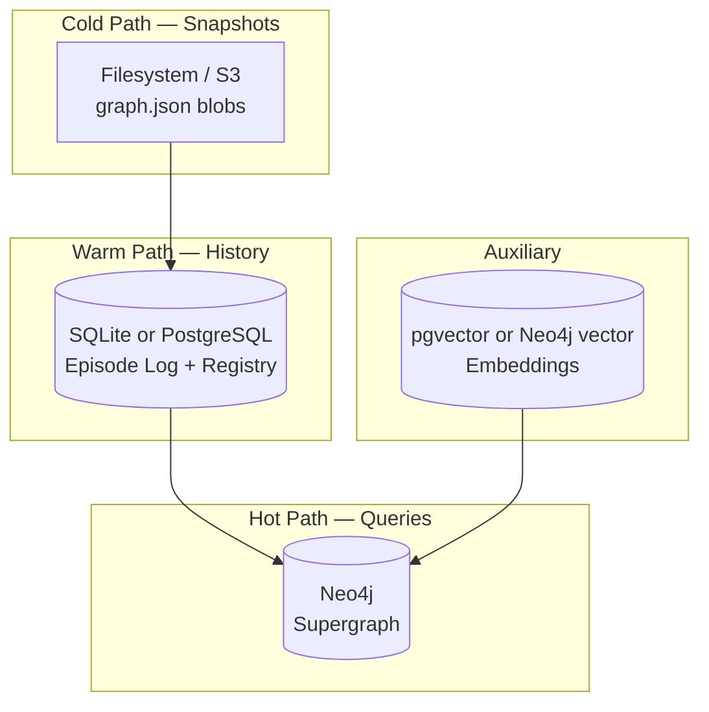

# 05 — Storage & Database Decision

## Requirements Recap

| Requirement | Storage Implication |
|-------------|---------------------|
| Multi-subgraph ingestion | Many immutable snapshot blobs |
| Entity resolution | Lookup by fingerprint, embedding similarity |
| Supergraph traversal | Fast k-hop, shortest path, cross-graph edges |
| Episodic versioning | Append-only log, validity windows |
| Time-travel | Filter by timestamp without full replay every query |
| LLM serving | Low-latency query (< 500ms target at moderate scale) |
| Offline / local dev | Must run on laptop without cloud dependency |

---

## Options Evaluated

### Option 1: NetworkX In-Memory Only

| Aspect | Assessment |
|--------|------------|
| **Fit** | Matches graphify internals |
| **Traversal** | Good for small graphs (< 50K nodes) |
| **Persistence** | Serialize to JSON — same bloat problem as graphify |
| **Temporal** | Manual: replay episodes into new NetworkX graph |
| **Concurrent access** | Poor |
| **Verdict** | **Prototype / unit tests only** |

### Option 2: Neo4j (Recommended for Supergraph)

| Aspect | Assessment |
|--------|------------|
| **Fit** | Native property graph, relationship-first |
| **Traversal** | Excellent — indexed relationship types |
| **Temporal** | Store assertions as relationship properties or separate `:Assertion` nodes |
| **Entity resolution** | Unique constraints on `fingerprint`; vector index (5.11+) |
| **Ops** | Docker / Neo4j Desktop for dev; Aura for cloud |
| **Verdict** | **Recommended Supergraph store** |

### Option 3: PostgreSQL + pgvector

| Aspect | Assessment |
|--------|------------|
| **Fit** | Strong for episode log + embeddings + metadata |
| **Traversal** | Recursive CTEs work but verbose and slower at depth > 4 |
| **Temporal** | Excellent — native timestamps, range types, partitioning |
| **Entity resolution** | pgvector is mature |
| **Verdict** | **Recommended for episode log + embeddings**; not primary traverser |

### Option 4: SQLite + NetworkX Hybrid

| Aspect | Assessment |
|--------|------------|
| **Fit** | Zero-config local dev |
| **Traversal** | Load graph into memory on startup |
| **Temporal** | SQLite JSONL episode log works well |
| **Verdict** | **Good MVP fallback** if Neo4j is too heavy initially |

### Option 5: RedisGraph / Memgraph / FalkorDB

| Aspect | Assessment |
|--------|------------|
| **Fit** | Fast in-memory graph |
| **Temporal** | Less mature patterns for bi-temporal data |
| **Verdict** | Consider if already in stack; otherwise Neo4j has richer ecosystem |

---

## Recommended Stack



| Layer | Technology | Stores |
|-------|------------|--------|
| **Snapshot blob store** | Filesystem (content-addressed dirs) | Raw `graph.json`, immutable |
| **Episode log** | SQLite (dev) / PostgreSQL (prod) | Episodes, ops, registry metadata |
| **Supergraph** | Neo4j 5.x | Canonical nodes, active assertions, cross-graph edges |
| **Embeddings** | pgvector sidecar OR Neo4j vector index | Node embedding vectors for Tier 3 resolution |
| **Config** | YAML files | `subgraphs.yaml`, `resolution_rules.yaml` |

---

## Why Not Store Everything in Neo4j?

Episode **operations JSON** can be large and append-heavy. Keeping the episode log in a relational store:

- Simpler backup / replay (sequential scan)
- Cheaper storage (no graph overhead per op)
- Neo4j holds **materialized active state** + indexes for query speed
- Episodes remain source of truth for audit and time-travel replay

---

## Neo4j Supergraph Model (Conceptual)

### Node Labels

| Label | Purpose |
|-------|---------|
| `:CanonicalNode` | Stable global entity |
| `:CanonicalEdge` | Logical edge identity (optional — can use rel-only model) |
| `:Subgraph` | Registered source metadata |

### Relationship Types

| Type | Purpose |
|------|---------|
| `:ALIAS_OF` | Local subgraph node → canonical node |
| `:ASSERTED_AT` | Links assertion metadata (or use relationship properties) |
| Dynamic (e.g., `:CALLS`, `:DOCUMENTS`, `:IMPLEMENTS`) | Domain edges with temporal props |

### Temporal Properties on Relationships

Store on each domain relationship (or parallel `:Assertion` node):

```
valid_from: datetime
valid_to: datetime | null
episode_id: string
confidence: float
provenance_subgraph: string
resolution_status: confirmed | tentative | contested
```

### Indexes & Constraints

```
UNIQUE (CanonicalNode.global_id)
UNIQUE (CanonicalNode.primary_fingerprint)
INDEX ON (CanonicalNode.entity_type)
INDEX ON ()-[r:CALLS]-() (r.valid_from, r.valid_to)  // temporal range queries
```

---

## SQLite Episode Log Schema (Summary)

See [02-temporal-schema-design.md](./02-temporal-schema-design.md) for full JSON schemas. Relational tables:

| Table | Purpose |
|-------|--------|
| `subgraphs` | Registered sources |
| `snapshots` | `(subgraph_id, hash, path, created_at)` |
| `episodes` | Append-only episode headers |
| `episode_ops` | Normalized ops (optional — or JSON blob per episode) |
| `local_aliases` | `(subgraph_id, snapshot_hash, local_id) → global_id` |
| `materialized_checkpoints` | Optional cached views at episode N |

---

## Scale Guidance

| Scale | Nodes | Edges | Recommendation |
|-------|-------|-------|----------------|
| **Small** | < 20K | < 100K | SQLite + in-memory NetworkX supergraph |
| **Medium** | 20K–500K | 100K–2M | Neo4j + SQLite episodes |
| **Large** | > 500K | > 2M | Neo4j cluster + PostgreSQL + checkpoint materialization |

For LLM memory (typical: code repo + docs + vault), **medium** is the expected band.

---

## Sync Strategy: Neo4j vs Episode Log

| Mode | When | How |
|------|------|-----|
| **Incremental apply** | Default on ingest | Apply episode ops directly to Neo4j |
| **Full rebuild** | Schema migration, corruption recovery | Replay all episodes from log |
| **Checkpoint** | Every N episodes or nightly | Export Neo4j + mark checkpoint episode_id |

Neo4j is a **projection** of the episode log — not the sole source of truth.

---

## graphify `global-graph.json` Relationship

Graphify already maintains `~/.graphify/global-graph.json` via `graphify global add`.

| Strategy | Description |
|----------|-------------|
| **Replace** | Episodic Engine supersedes global graph for multi-source queries |
| **Import bootstrap (recommended)** | One-time import of existing global graph as initial Supergraph seed |
| **Coexist** | Keep graphify global for backward compat; episodic wraps it with temporal layer |

Do not fight graphify's union-merge — ingest its output as subgraph snapshots.

---

## Deployment Profiles

> **Approved:** Hybrid profile ([09-hybrid-architecture.md](./09-hybrid-architecture.md)). The A/B profiles below are modes within hybrid, not mutually exclusive choices.

### Mode: hybrid-local (Default)

```
Docker: neo4j:5-community
SQLite: ~/.episodic-engine/episodes.db
Blobs: ~/.episodic-engine/snapshots/
NetworkX: LRU subgraph cache
graphify: host-installed, subgraph query delegate
```

### Mode: hybrid-lite (CI / Offline Fallback)

```
SQLite: ~/.episodic-engine/episodes.db
Blobs: ~/.episodic-engine/snapshots/
Supergraph: NetworkX in-memory (no Neo4j)
Reduced cross-graph; full ingest + temporal replay still works
```

### Mode: hybrid-team (Shared — Phase 3)

```
Neo4j Aura or self-hosted
PostgreSQL for episode log
S3/MinIO for snapshot blobs
pgvector for embeddings
CI: graphify hook → episodic ingest webhook
```

All modes share the same **StoragePort** interfaces — switch via `config.yaml`, not code fork.

---

## Decision Matrix

| Criterion | NetworkX | Neo4j | Postgres-only |
|-----------|----------|-------|---------------|
| Traversal speed | ★★★ (small) | ★★★★★ | ★★ |
| Temporal audit | ★★ | ★★★★ | ★★★★★ |
| Local dev ease | ★★★★★ | ★★★ | ★★★★ |
| Cross-graph queries | ★★ | ★★★★★ | ★★ |
| Entity resolution | ★★ | ★★★★ | ★★★★★ |
| Ops complexity | ★★★★★ | ★★★ | ★★★★ |

**Final recommendation:** Neo4j (Supergraph) + SQLite/PostgreSQL (episodes) + filesystem blobs (snapshots).
