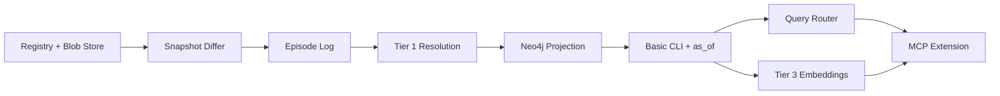

# 07 — Feature Backlog & Phasing

## MVP Definition (Phase 1)

Minimum viable Episodic Engine — proves the core loop without full LLM routing sophistication.

### In Scope

| Feature | Description |
|---------|-------------|
| Subgraph registry | Register named sources pointing at graphify output dirs |
| Snapshot ingestion | Hash + store `graph.json` blobs immutably |
| Snapshot differ | Emit delta ops vs prior snapshot of same subgraph |
| Episode log | Append-only SQLite log of episodes |
| **StoragePort interfaces** | Pluggable backends (local drivers in Phase 1; team drivers Phase 3) |
| Tier 1 entity resolution | Fingerprint-based merge + local alias mapping |
| Neo4j projection | Apply ops to Supergraph (active assertions only) |
| Basic CLI | `ingest`, `status`, `query --scope supergraph`, `query --subgraph X` |
| Time-travel (basic) | `--as-of` via episode replay or Neo4j temporal filters |
| graphify bootstrap | Import existing `graph.json` + optional `global-graph.json` |

### Out of Scope (Phase 1)

| Feature | Defer To |
|---------|----------|
| LLM query router | Phase 2 |
| Tier 3/4 entity resolution (embeddings, LLM) | Phase 2 |
| Hybrid query expansion | Phase 2 |
| Human resolution UI | Phase 2 |
| MCP server extensions | Phase 2 |
| Multi-tenant / team sync | Phase 3 |
| Automatic source watcher / CI webhook | Phase 2 |

---

## Phase 2: Intelligence Layer

| Feature | Priority | Effort |
|---------|----------|--------|
| Rule + LLM hybrid query router | P0 | Medium |
| Embedding-based entity resolution (Tier 3) | P0 | Medium |
| LLM adjudication for borderline merges (Tier 4) | P1 | Low |
| `resolution_rules.yaml` human overrides | P1 | Low |
| MCP tools: `query_episodic_graph`, `get_entity_history` | P1 | Medium |
| Temporal diff command (`episodic diff`) | P1 | Medium |
| Checkpoint materialization | P1 | Medium |
| graphify hook integration (post-commit ingest) | P2 | Low |
| Contested/tentative link surfacing in context | P2 | Low |

---

## Phase 3: Scale & Team

| Feature | Priority |
|---------|----------|
| PostgreSQL episode log (replace SQLite) | P1 |
| S3/MinIO snapshot store | P2 |
| Neo4j clustering / Aura | P2 |
| CI/CD ingest pipeline | P1 |
| Access control per subgraph | P2 |
| Audit dashboard (episode timeline UI) | P3 |
| Conflict resolution workflow UI | P3 |

---

## Feature Decision Log

Technical choices already made in planning docs:

| Decision | Choice | Rationale |
|----------|--------|-----------|
| Versioning model | Delta episodes + validity windows | Avoids bloat; Git-proven pattern |
| Supergraph DB | Neo4j | Native traversal, temporal rel props |
| Episode store | SQLite → PostgreSQL | Append-only, cheap, auditable |
| Subgraph storage | Content-addressed blobs | Immutable, dedupes identical regens |
| Resolution order | Deterministic → structural → embedding → LLM | Cost + reproducibility |
| graphify relationship | Wrap, ingest output | Don't fork extraction pipeline |
| Router MVP | Rule-based | Debuggable; LLM router in Phase 2 |
| Time-travel default | Semantic validity time | Matches user mental model |
| Deployment profile | **Hybrid** | Local-first + pluggable backends; see doc 09 |

---

## Open Features (Need Your Input)

### Feature: Automatic Cross-Graph Edge Inference

Should Phase 1 create synthetic edges (`IMPLEMENTS`, `DOCUMENTS`) automatically, or only after explicit resolution?

| Option | Trade-off |
|--------|-----------|
| **A: Phase 1 — rule-based only** | Wikilink + file path patterns only; safe, limited |
| **B: Phase 2 — full inference** | Better linking; risk of false positives |
| **Recommendation** | **A** for MVP |

### Feature: Episode Granularity

When should a new episode be created?

| Option | Trade-off |
|--------|-----------|
| **Per graphify run** | Simple; one episode per regen |
| **Per git commit** | Aligns with dev workflow; graphify hook already exists |
| **Batched (hourly cron)** | Fewer episodes; loses commit-level precision |
| **Recommendation** | **Per graphify run**, with optional git commit metadata attached |

### Feature: Supergraph Staleness

If code subgraph is fresh but docs subgraph is 30 days old, should router warn?

| Option | Trade-off |
|--------|-----------|
| **Warn always** | Transparent; noisy |
| **Warn on cross-graph queries only** | Balanced |
| **Never warn** | Cleaner UX; hides problems |
| **Recommendation** | **Warn on cross-graph queries only** |

---

## Deployment Profile: Hybrid (Approved)

**Decision:** Hybrid structure — not A, B, or C alone. See [09-hybrid-architecture.md](./09-hybrid-architecture.md).

| Aspect | Hybrid Choice |
|--------|---------------|
| Default mode | `hybrid-local` — SQLite + local blobs + Neo4j Desktop |
| Fallback mode | `hybrid-lite` — NetworkX in-memory supergraph (CI / offline) |
| Team mode | `hybrid-team` — PostgreSQL + S3 + Neo4j Aura (config swap) |
| Query engines | graphify for subgraph; Neo4j for supergraph; merge for hybrid |
| Phase 1 requirement | **StoragePort interfaces** — build local drivers first, team drivers in Phase 3 |

---

## Success Metrics by Phase

### Phase 1 Exit Criteria

- [ ] Ingest two graphify outputs (code + docs) into registry
- [ ] Tier 1 resolution links doc concept to code module with traceable episode
- [ ] Regenerating unchanged source produces **zero** new ops
- [ ] `--as-of` query returns different results before/after a known change
- [ ] Supergraph path query crosses subgraph boundary in < 500ms (100K node test)

### Phase 2 Exit Criteria

- [ ] Router correctly classifies 90%+ of 50-query benchmark
- [ ] Tier 3 resolution improves cross-link recall by 20%+ over Tier 1 alone
- [ ] MCP tool usable from Cursor / Claude Code
- [ ] Temporal diff shows accurate auth module changes over 30-day window

---

## Risk Register

| Risk | Impact | Mitigation |
|------|--------|------------|
| graphify node ID instability across regens | Broken diffs | Fingerprint-first identity; local alias table |
| False entity merges | Wrong LLM context | Tentative/contested flags; never auto-merge below 0.85 |
| Neo4j ops burden | Dev friction | Docker Compose one-liner; SQLite fallback mode |
| Episode log growth | Disk usage | Ops are small vs snapshots; checkpoint + archive old blobs |
| graphify schema changes | Ingest breakage | Pin graphify version; schema adapter layer |
| Time-travel query latency | Bad UX | Checkpoints every 50 episodes; cache rounded as_of |

---

## Suggested Build Order

Each box is a independently testable milestone.

---

## Next Steps After Plan Approval

1. ~~Answer deployment profile~~ — **Hybrid** approved ([09](./09-hybrid-architecture.md))
2. Review [02-temporal-schema-design.md](./02-temporal-schema-design.md) assertion model
3. Review [09-hybrid-architecture.md](./09-hybrid-architecture.md) StoragePort interfaces
4. Approve Phase 1 scope boundaries
5. Proceed to implementation plan (writing-plans skill) — separate session
