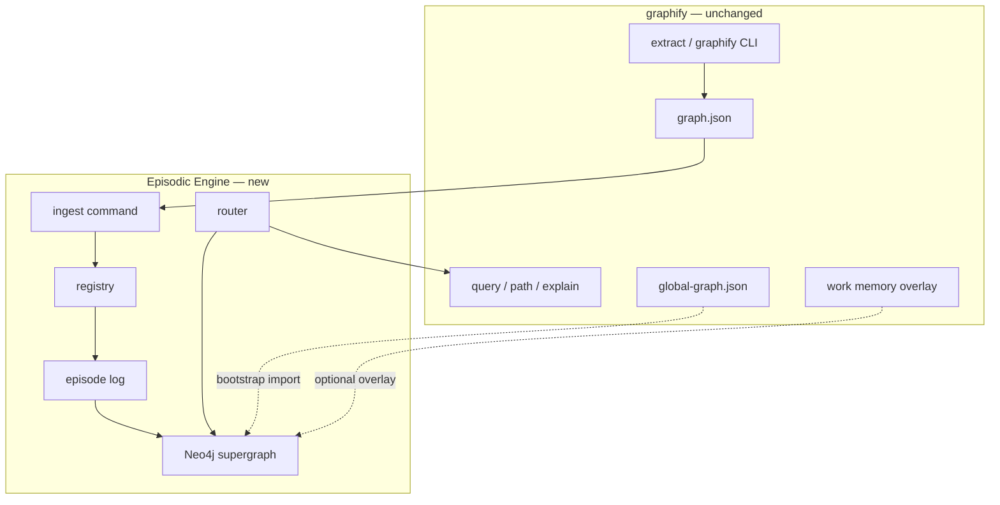

# 08 — Graphify Integration

Graphify is the **first ingestion compiler** in the [Grand Plan](./episodic-grand-plan.md) (Phase 1): it produces per-corpus structure today; Episodic adds versioning, cross-corpus merge, and (later) harness-facing retrieval. Multi-resolution claims/summaries beyond graphify’s node model are research extensions on the same provenance spine ([02](./02-temporal-schema-design.md)).

## What graphify Gives Us

Graphify ([safishamsi/graphify](https://github.com/safishamsi/graphify)) is the **extraction and per-corpus query layer**. Episodic Engine must treat it as an upstream dependency, not a fork target.

### Outputs (per run)

```
graphify-out/
├── graph.json          # Full NetworkX-serialized graph
├── graph.html          # Interactive visualization
├── GRAPH_REPORT.md     # God nodes, communities, suggested questions
└── cache/              # Incremental rebuild cache
```

### Extraction Pipeline

| Pass | Method | Cost |
|------|--------|------|
| Code (20+ languages) | Tree-sitter AST | Free, local, deterministic |
| Docs, PDFs, images | LLM semantic extraction | API cost via IDE model |
| SQL schemas | Optional `[sql]` extra | Local introspection |

### Built-in Query Tools

```bash
graphify query "show the auth flow" --graph graphify-out/graph.json
graphify path "NodeA" "NodeB" --graph graphify-out/graph.json
graphify explain "authenticate_user" --graph graphify-out/graph.json
```

### MCP Server

```bash
python -m graphify.serve graphify-out/graph.json
```

Tools: `query_graph`, `get_node`, `get_neighbors`, `shortest_path`

### Multi-Project Merge (Existing)

```bash
graphify global add graphify-out/graph.json --as myrepo
graphify global query "what connects auth to billing?"
```

Maintains `~/.graphify/global-graph.json` — a static supergraph without temporal model.

### Git Integration

```bash
graphify hook install
```

- Auto-rebuild on commit (AST only, no API cost)
- Union-merge driver for `graph.json` conflicts

### Work Memory Overlay

```bash
graphify save-result --question "Q" --answer "A" --nodes Foo Bar --outcome useful
graphify reflect --graph graphify-out/graph.json
```

Produces `.graphify_learning.json` with node tags: `preferred`, `tentative`, `contested`.

---

## Integration Architecture



**Principle:** graphify continues to produce and query per-corpus graphs. Episodic Engine adds registry, temporal episodes, cross-source resolution, and supergraph queries.

---

## Ingest Adapter: graph.json → Subgraph Snapshot

### Expected graphify Node Shape (Inferred)

Graphify uses NetworkX `node_link_data` compatible JSON. Typical node fields:

| Field | Example | Episodic Use |
|-------|---------|--------------|
| `id` | `"node_442"` | Local ID (snapshot-scoped) |
| `label` / `name` | `"authenticate_user"` | Display + resolution |
| `type` | `"function"`, `"module"`, `"concept"` | Type compatibility in resolution |
| `file` / `path` | `"src/auth.py"` | Fingerprint |
| `qualified_name` | `"AuthService.authenticate_user"` | Fingerprint |
| `community` | `3` | Structural blocking |
| `summary` / `docstring` | `"Validates JWT..."` | Embedding input |

### Expected Edge Shape

| Field | Example | Episodic Use |
|-------|---------|--------------|
| `source` / `target` | local node IDs | Map via alias table |
| `type` / `label` | `"CALLS"`, `"IMPORTS"`, `"references"` | Preserve in assertions |
| `weight` | `1.0` | Path ranking |

### Adapter Responsibilities

1. **Validate** graph.json schema version (pin graphify >= 0.9.x)
2. **Normalize** node fields → internal fingerprint format
3. **Reject** graphs with git conflict markers (graphify documents this edge case)
4. **Dedup** known ghost duplicates before diffing (graphify FAQ: use `--force`)
5. **Attach metadata**: graphify version, extraction timestamp, source path

---

## When to Invoke graphify

| Trigger | graphify Command | Episodic Action |
|---------|------------------|-----------------|
| Initial setup | `graphify .` per source | `episodic init` once + `episodic save --id X --source ...` (registers on first save) |
| Code change (git commit) | Hook auto-runs AST rebuild | `episodic save --id X --source ...` |
| Docs/PDF change | `graphify --update ./docs` | `episodic save --id X --source ...` with semantic delta |
| Manual refresh | `graphify . --force` | Full snapshot diff |
| Cross-project | `graphify global add` | Optional bootstrap only |

### Recommended Wrapper

```bash
# Episodic wrapper — runs graphify then saves (Phase 2 convenience; current slice: run `episodic save` directly)
episodic save --id myrepo-code --source ~/dev/myrepo
# Internally (slice behavior): graphify ~/dev/myrepo && persist snapshot + episode
```

---

## Query Delegation Strategy

| Query Type | Handler |
|------------|---------|
| Single subgraph, current state | **Delegate to graphify** (`query`, `path`, `explain`) |
| Supergraph, cross-source | **Episodic Neo4j traverser** |
| Temporal (any scope) | **Episodic materializer** → optionally delegate expanded subgraph to graphify |
| Work memory / learning | **Merge graphify overlay** into context packager |

Do not reimplement graphify's structural query ranking — it already optimizes for LLM token budgets.

---

## Bootstrapping from global-graph.json

For users with existing graphify global setup:

1. Import `~/.graphify/global-graph.json` as **seed Supergraph**
2. Create synthetic `{subgraph_id}__ep_000000` with `trigger_type: bootstrap_import`
3. Register each `--as` alias as a subgraph entry
4. Subsequent per-subgraph ingests emit proper delta episodes

This avoids re-merging from scratch while adding temporal layer retroactively (all bootstrap assertions get `valid_from = import_time`).

---

## Work Memory Overlay Integration

Graphify's `.graphify_learning.json` tracks query outcomes and node confidence. Episodic Engine should:

| Overlay Field | Episodic Mapping |
|---------------|------------------|
| `preferred` nodes | Boost in router context ranking |
| `tentative` nodes | Surface in LLM warnings |
| `contested` nodes | Block auto-merge; require human rule |
| Query log entries | Feed subgraph affinity scorer |

Store overlay references in episode metadata — not duplicate the full overlay.

---

## graphify Features We Explicitly Do NOT Duplicate

| graphify Feature | Reason |
|------------------|--------|
| Tree-sitter AST extraction | Upstream responsibility |
| LLM semantic doc extraction | Upstream responsibility |
| `graph.html` visualization | Use as-is; optionally link from episodic UI |
| Union-merge git driver | Keep for per-repo graph.json; episodic handles cross-repo |
| Community detection / Leiden | Read community IDs from graphify output |

---

## Version Pinning & Compatibility

| Policy | Detail |
|--------|--------|
| Minimum graphify version | `0.9.2` (current stable at planning time) |
| PyPI package | `graphifyy` (double-y) |
| Schema adapter | Version field in graph.json; adapter per major version |
| Test fixture | Pin sample graph.json from graphify repo in test data |

When graphify changes node schema, update adapter — do not mutate stored snapshots (immutable).

---

## Conflict: graphify global vs Episodic Supergraph

Both merge multiple graphs. Coexistence strategy:

| Use Case | Tool |
|----------|------|
| Quick cross-project query, no history | `graphify global query` |
| Temporal, audited, LLM memory | `episodic query --scope supergraph` |
| Bootstrap | Import global graph once |

Long term, Episodic Supergraph **supersedes** global-graph for power users; document migration path.

---

## Environment Variables (Inherited)

Episodic Engine inherits graphify's runtime config where relevant:

| Variable | Relevance |
|----------|-----------|
| `GRAPHIFY_MAX_GRAPH_BYTES` | Pass through on ingest validation |
| `GRAPHIFY_FORCE` | Pass through on refresh wrapper |
| `GRAPHIFY_QUERY_LOG` | Router reads for affinity scoring |

New episodic-specific:

| Variable | Purpose |
|----------|---------|
| `EPISODIC_DATA_DIR` | Default `~/.episodic-engine` |
| `EPISODIC_NEO4J_URI` | Supergraph connection |
| `EPISODIC_EPISODE_DB` | SQLite path |

---

## Docker Compose Dev Stack (Planning)

```yaml
# Conceptual — not implementation
services:
  neo4j:
    image: neo4j:5-community
    ports: ["7474:7474", "7687:7687"]
  # graphify runs on host via uv tool install
  # episodic CLI connects to neo4j + local sqlite
```

graphify stays host-installed (`uv tool install graphifyy`); only Neo4j containerized for dev.

---

## Summary

| Layer | Owner |
|-------|-------|
| Extraction | graphify |
| Per-corpus query | graphify |
| Snapshot storage | Episodic Engine |
| Episode / temporal | Episodic Engine |
| Cross-source supergraph | Episodic Engine |
| Query routing | Episodic Engine (delegates subgraph queries to graphify) |

**Build the bridge, not a second graphify.**
