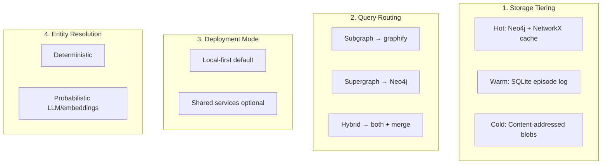
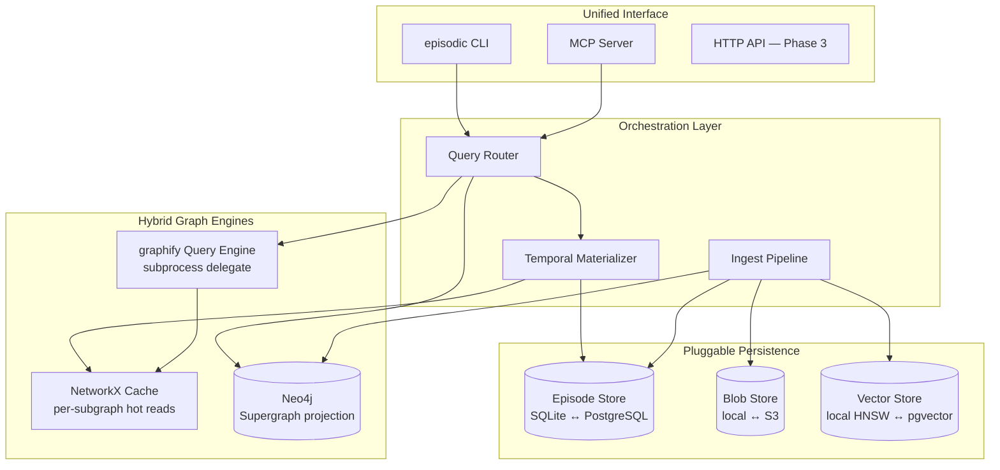
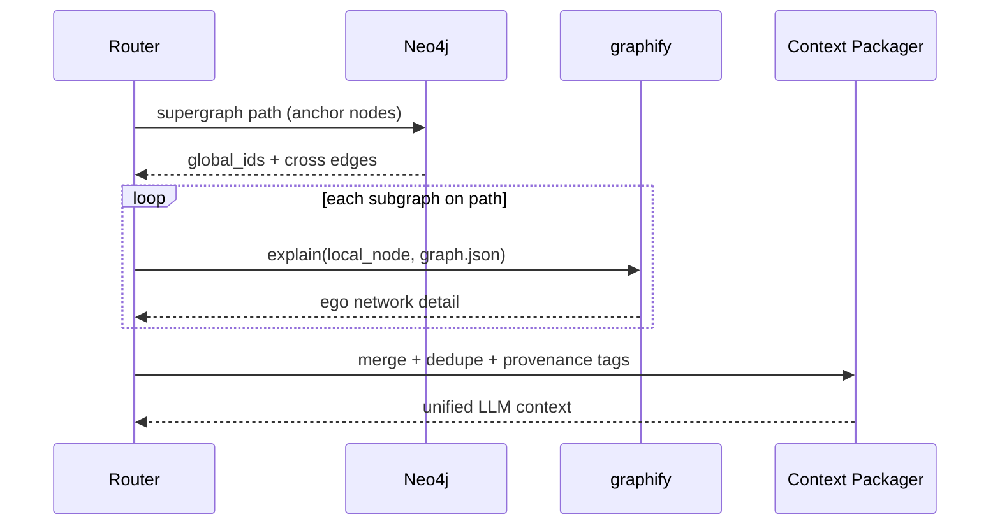

# 09 — Hybrid Architecture (Approved Profile)

**Decision:** Episodic Engine uses a **hybrid structure** — not purely local, not purely cloud, not a single database. Multiple specialized layers cooperate through stable interfaces, and each layer can scale independently.

This document is the canonical reference for that decision. It supersedes the A/B/C profile choice in [07-feature-backlog-and-phasing.md](./07-feature-backlog-and-phasing.md).

---

## Hybrid in Four Dimensions



| Dimension | Hybrid Choice |
|-----------|---------------|
| **Storage** | Hot graph projection + warm audit log + cold snapshots |
| **Query** | Delegate local/current to graphify; global/temporal to episodic |
| **Deployment** | Runs fully offline on laptop; same code syncs to shared infra |
| **Resolution** | Cheap rules first; ML/LLM only when rules fail |

---

## Layer Model



Every persistence backend implements a **StoragePort** interface — swap implementations via config, not code changes.

---

## Storage Tiering (Hot / Warm / Cold)

| Tier | Technology | Data | Access Pattern |
|------|------------|------|----------------|
| **Hot** | Neo4j + in-memory NetworkX | Active Supergraph assertions; cached subgraph views | Read-heavy queries, traversal |
| **Warm** | SQLite (default) / PostgreSQL (shared) | Episode log, registry, aliases, checkpoints | Append on ingest; sequential replay |
| **Cold** | Local filesystem (default) / S3 (shared) | Immutable `graph.json` snapshots | Write-once; content-addressed |

### Why Three Tiers

- **Cold** preserves raw graphify truth — replayable, diffable, cheap
- **Warm** is the audit source of truth — episodes never deleted
- **Hot** is a disposable projection — rebuild from warm + cold anytime

Neo4j and NetworkX are **not** source of truth. They are query-optimized materializations.

---

## Dual Graph Engine Strategy

| Engine | Scope | When Used |
|--------|-------|-----------|
| **graphify + NetworkX** | Single subgraph, current state | "What calls X?", "explain auth.py" |
| **Neo4j** | Supergraph, cross-source, temporal edges | "Link spec to code", "path across vault + repo" |
| **Materializer (NetworkX)** | Point-in-time subgraph view | `--as-of` on a single source |

### NetworkX Cache Role

- On ingest, optionally load latest subgraph snapshot into an LRU NetworkX graph keyed by `subgraph_id`
- graphify query commands run against cached snapshot (or live `graph.json` path)
- Avoids round-tripping through Neo4j for queries graphify already handles well
- Cache invalidated on new snapshot ingest for that subgraph

### Neo4j Role

- Holds canonical nodes (`global_id`), cross-graph edges, temporal assertion metadata
- Receives incremental episode ops on ingest
- Serves supergraph and hybrid queries only

**Rule:** Never duplicate graphify's query ranking logic in Neo4j for single-subgraph questions.

---

## Pluggable Backend Configuration

Single config file (`~/.episodic-engine/config.yaml`) selects backends:

```yaml
# Hybrid profile — local-first, team-ready
deployment: hybrid

storage:
  episode_log:
    driver: sqlite          # switch to: postgres
    path: ~/.episodic-engine/episodes.db
    # postgres_url: postgresql://...   # uncomment for team mode

  snapshots:
    driver: local           # switch to: s3
    path: ~/.episodic-engine/snapshots/
    # s3_bucket: episodic-snapshots
    # s3_endpoint: http://minio:9000

  supergraph:
    driver: neo4j           # switch to: networkx (fallback/dev-lite)
    uri: bolt://localhost:7687
    # fallback: load into memory for CI smoke tests

  embeddings:
    driver: local           # switch to: pgvector
    path: ~/.episodic-engine/vectors/
    # pgvector_url: postgresql://...

  subgraph_cache:
    enabled: true
    max_subgraphs: 5
    max_nodes_per_graph: 100000

graphify:
  binary: graphify          # uv tool install graphifyy
  delegate_subgraph_queries: true
```

### Mode Matrix

| Mode | episode_log | snapshots | supergraph | Typical Use |
|------|-------------|-----------|------------|-------------|
| **hybrid-local** | SQLite | filesystem | Neo4j Desktop | Daily dev (default) |
| **hybrid-lite** | SQLite | filesystem | NetworkX in-memory | CI / smoke tests |
| **hybrid-team** | PostgreSQL | S3/MinIO | Neo4j Aura | Shared team memory |
| **hybrid-offline** | SQLite | filesystem | NetworkX | No Docker; reduced cross-graph |

Same Python codebase, different config. No fork.

---

## Hybrid Query Flow

Already detailed in [04-query-routing-engine.md](./04-query-routing-engine.md). Hybrid structure adds explicit **merge step**:



| Query Scope | Primary Engine | Secondary | Merge |
|-------------|----------------|-----------|-------|
| `subgraph` | graphify | Materializer if `--as-of` | No |
| `supergraph` | Neo4j | — | No |
| `hybrid` | Neo4j (anchors) | graphify (expansion) | Yes |

---

## Hybrid Deployment Topology

### Local Developer (Default)

```
┌─────────────────────────────────────────────┐
│  Laptop                                     │
│  ┌──────────┐  ┌─────────┐  ┌───────────┐ │
│  │ graphify │  │ episodic│  │ Neo4j     │ │
│  │ (host)   │→ │ CLI     │→ │ Desktop   │ │
│  └──────────┘  └────┬────┘  └───────────┘ │
│                     │                       │
│              ~/.episodic-engine/           │
│              ├── episodes.db  (SQLite)     │
│              ├── snapshots/   (blobs)      │
│              ├── vectors/     (local HNSW)  │
│              └── config.yaml               │
└─────────────────────────────────────────────┘
```

### Team Extension (Same Code, Different Config)

```
┌──────────────┐     ┌─────────────────────────────────┐
│ Developer    │     │ Shared                          │
│ episodic CLI │────→│ PostgreSQL (episodes)           │
│ graphify     │     │ S3/MinIO (snapshots)            │
└──────────────┘     │ Neo4j Aura (supergraph)         │
                     │ pgvector (embeddings)           │
                     └─────────────────────────────────┘
                              ↑
                     ┌────────┴────────┐
                     │ CI: ingest hook │
                     └─────────────────┘
```

Local developers can work offline against SQLite + local Neo4j. `episodic sync push` (Phase 3) publishes episodes + snapshots to shared stores.

---

## Hybrid Temporal Model

Combines two time axes without duplication:

| Axis | Stored In | Used For |
|------|-----------|----------|
| **Semantic validity** (`valid_from`/`valid_to`) | Neo4j assertion props + episode ops | "What was true in the source world at T?" |
| **Record time** (`recorded_at`) | Episode log | "What had we ingested by T?" |

Default `--as-of` = semantic. `--as-of-recorded` available for audit/debug.

Materialization hybrid:
1. Find checkpoint in warm store (nearest episode ≤ as_of)
2. Load cold snapshot if exact boundary match (fast path)
3. Replay warm episode ops into NetworkX view
4. Optionally verify against Neo4j projection

---

## Hybrid Entity Resolution

Tier pipeline unchanged ([03-entity-resolution.md](./03-entity-resolution.md)). Hybrid addition:

| Tier | Engine | Storage |
|------|--------|---------|
| 1 — Deterministic | Rule engine | Fingerprint index in episode log |
| 2 — Structural | NetworkX neighborhood compare | Computed on ingest, not persisted |
| 3 — Embedding | local HNSW or pgvector | Vector store (pluggable) |
| 4 — LLM | External API | Decision cached in episode log |

Tiers 1–2 run on every ingest (offline-capable). Tiers 3–4 opt-in via config flag.

---

## Phase Alignment Under Hybrid

| Phase | Hybrid Deliverables |
|-------|---------------------|
| **Phase 1** | StoragePort interface; hybrid-local config; SQLite + local blobs + Neo4j; graphify delegation; Tier 1 resolution |
| **Phase 2** | Hybrid query merge; rule+LLM router; local vector store; checkpoint materialization |
| **Phase 3** | hybrid-team config; episodic sync; PostgreSQL + S3 adapters; shared Neo4j |

Phase 1 builds the **port interfaces** even if only local drivers exist — this prevents a rewrite when scaling.

---

## StoragePort Interface (Conceptual)

| Port | Methods | Local Driver | Team Driver |
|------|---------|--------------|-------------|
| `EpisodeStore` | append, range, checkpoint | SQLite | PostgreSQL |
| `BlobStore` | put, get, exists | filesystem | S3 |
| `SupergraphStore` | apply_ops, query, shortest_path | Neo4j | Neo4j Aura |
| `VectorStore` | upsert, search | local HNSW file | pgvector |
| `SubgraphCache` | get, invalidate | NetworkX LRU | Redis (optional) |

All ingest and query code depends on ports — never on driver specifics.

---

## What Hybrid Explicitly Avoids

| Anti-Pattern | Hybrid Alternative |
|--------------|-------------------|
| Single monolithic JSON supergraph | Tiered storage |
| Neo4j for everything including raw snapshots | Cold blob store |
| Reimplementing graphify queries in Cypher | Delegate to graphify for subgraph scope |
| Big-bang cloud deployment | Config-driven backend swap |
| Full graph copy per episode | Delta episodes + projections |

---

## Success Criteria (Hybrid-Specific)

- [ ] Same ingest pipeline runs with `hybrid-local` and `hybrid-lite` configs
- [ ] Subgraph query latency matches native graphify (delegation, not reimplementation)
- [ ] Supergraph cross-source query works in Neo4j mode
- [ ] Switching `episode_log.driver: sqlite → postgres` requires config change only
- [ ] Cold snapshot replay reproduces identical episode ops after full warm-store rebuild

---

## Related Documents

| Topic | Doc |
|-------|-----|
| Component architecture | [01-architecture-overview.md](./01-architecture-overview.md) |
| Temporal schema | [02-temporal-schema-design.md](./02-temporal-schema-design.md) |
| Query routing / hybrid merge | [04-query-routing-engine.md](./04-query-routing-engine.md) |
| Storage options | [05-storage-and-database-decision.md](./05-storage-and-database-decision.md) |
| graphify delegation | [08-graphify-integration.md](./08-graphify-integration.md) |
| Build phasing | [07-feature-backlog-and-phasing.md](./07-feature-backlog-and-phasing.md) |
