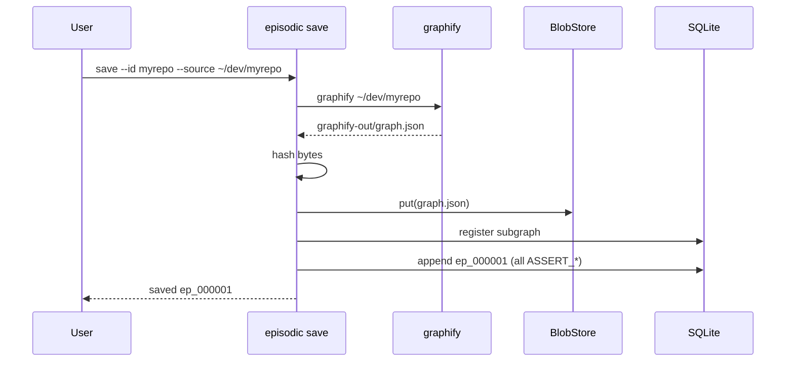
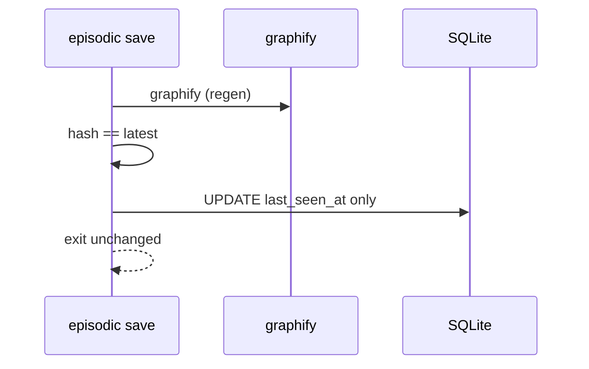
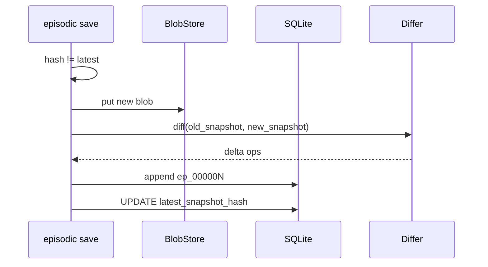

# PRD — Single Subgraph Save

**Status:** Approved via grilling (2026-07-06)  
**Slice:** Cold + warm storage only — **no Neo4j, no supergraph, no query router**  
**Parent docs:** [09-hybrid-architecture.md](../09-hybrid-architecture.md), [02-temporal-schema-design.md](../02-temporal-schema-design.md)

---

## Problem

Graphify produces a static `graph.json` per corpus run. Episodic Engine needs a **durable, versioned record** of that output before supergraph synthesis or Neo4j projection exist.

This slice delivers: **run graphify on a source → save one registered subgraph with episodic history**.

---

## Locked Decisions (Grilling)

| # | Question | Decision |
|---|----------|----------|
| 1 | Minimum artifact set | **B — Cold + warm:** content-addressed blob + SQLite registry/episode log. Bootstrap episode on first save. No Neo4j. |
| 2 | Setup vs graphify | **C — Full pipeline:** init installs/checks graphify; save runs graphify then persists. |
| 3 | Identical re-save (same SHA-256) | **B — No-op + touch:** no new episode, no blob rewrite; update registry `last_seen_at`. |
| 4 | Changed re-save (new hash) | **A — Diff episode:** append delta ops (`ASSERT_*` / `RETRACT_*` / `UPDATE_*`). |
| 5 | User interface | **C — Python CLI:** `episodic init`, `episodic save`. |
| 6 | Init requirement | **B — Explicit init:** `episodic save` fails if init not run. |
| 7 | graphify mode on save | **Full default:** AST + semantic extraction (graphify's normal behavior). |

---

## Goals

1. **`episodic init`** — one-time local setup: dirs, config, SQLite schema, graphify install check.
2. **`episodic save --id <subgraph_id> --source <path>`** — run graphify, persist snapshot, write episode(s).
3. **Idempotent saves** when source graph unchanged (hash match).
4. **Delta episodes** when graph changes.
5. **Inspectable state** via `episodic status`.

---

## Non-Goals (This Slice)

- Neo4j / supergraph projection
- Cross-subgraph entity resolution (Tier 1+)
- Query router, time-travel CLI, MCP
- `episodic refresh` / git hooks
- Team mode (PostgreSQL, S3)
- Bootstrap import from `global-graph.json`

---

## User Stories

| As a… | I want to… | So that… |
|-------|------------|----------|
| Developer | run `episodic init` once | my local episodic store exists before saving |
| Developer | run `episodic save --id myrepo --source ~/dev/myrepo` | graphify output is versioned in episodic storage |
| Developer | re-run save without source changes | nothing duplicates; registry shows fresh `last_seen_at` |
| Developer | re-run save after a refactor | a diff episode records what changed |
| Developer | run `episodic status` | I see registered subgraphs, latest hash, episode count |

---

## Commands

### `episodic init`

**Does:**
1. Create `~/.episodic-engine/` (or path from `EPISODIC_DATA_DIR`)
2. Write `config.yaml` from template if missing
3. Initialize SQLite schema (`episodes.db`)
4. Create `snapshots/` blob directory
5. Install or verify `graphify` CLI (`uv tool install graphifyy` if missing)
6. Print success + paths

**Does not:** run graphify, register subgraphs.

**Fails if:** unwritable data dir, SQLite init error, graphify install fails.

---

### `episodic save`

```
episodic save --id <subgraph_id> --source <path> [--graphify-out <path>]
```

**Precondition:** `episodic init` completed (marker file or schema exists).

**Does:**
1. Validate `subgraph_id` (slug: `[a-z0-9][a-z0-9_-]*`)
2. Run `graphify <source>` (full default extraction) → `graphify-out/graph.json`
3. Read `graph.json` bytes → SHA-256 hash
4. **If hash == latest snapshot hash for this subgraph_id:**
   - Skip blob write, skip episode
   - Update registry `last_seen_at`
   - Exit 0 with message `unchanged`
5. **Else:**
   - Store blob at content-addressed path (skip if hash exists globally)
   - Register/update subgraph in SQLite
   - **First save:** emit bootstrap episode `ep_000001` with all nodes/edges as `ASSERT_*`
   - **Subsequent save:** diff vs prior snapshot → delta episode
   - Update registry `latest_snapshot_hash`, `last_seen_at`, counts
6. Print summary: episode id, ops count, node/edge counts

**Default `--graphify-out`:** `<source>/graphify-out`

---

### `episodic status`

Print table: `subgraph_id`, `latest_hash` (short), `episodes`, `last_seen_at`, `source_path`.

---

## Data Model

### Registry (`subgraphs` table)

| Column | Type | Notes |
|--------|------|-------|
| `subgraph_id` | TEXT PK | User-provided slug |
| `source_path` | TEXT | Last used `--source` |
| `graphify_out_path` | TEXT | Where graph.json is read |
| `latest_snapshot_hash` | TEXT | `sha256:...` |
| `registered_at` | TEXT ISO8601 | First save |
| `last_seen_at` | TEXT ISO8601 | Updated every save attempt |

### Snapshots (blob store)

- Path: `{snapshots_dir}/{hash[7:9]}/{hash}.json`
- Key: `sha256:{hex}`
- Immutable; deduplicated across subgraphs

### Episodes (`episodes` table)

Per [02-temporal-schema-design.md](../02-temporal-schema-design.md), simplified for this slice:

| Column | Type |
|--------|------|
| `episode_id` | TEXT PK (`ep_000001`) |
| `sequence` | INTEGER (per subgraph, monotonic) |
| `recorded_at` | TEXT ISO8601 |
| `subgraph_id` | TEXT FK |
| `snapshot_hash` | TEXT |
| `trigger_type` | TEXT (`graphify_regen`) |
| `operations_json` | TEXT (JSON array) |
| `stats_json` | TEXT |

Operation types used in this slice: `ASSERT_NODE`, `UPDATE_NODE`, `RETRACT_NODE`, `ASSERT_EDGE`, `RETRACT_EDGE`.

Each op includes `global_id` (UUID), `fingerprint`, `properties`, `local_ref`.

---

## Flows

### First Save



### Re-save — Unchanged



### Re-save — Changed



---

## Fingerprints (Diff Identity)

Stable keys for diffing (same as planning doc 03, Tier 1 subset):

```
function:{file}:{qualified_name}
module:{file}:{name}
concept:{file}:{normalized_label}
fallback:{type}:{file}:{normalized_label}
```

Edges keyed by: `(src_fingerprint, tgt_fingerprint, edge_type)`.

---

## Config (`~/.episodic-engine/config.yaml`)

```yaml
deployment: hybrid-local

storage:
  episode_log:
    driver: sqlite
    path: ~/.episodic-engine/episodes.db
  snapshots:
    driver: local
    path: ~/.episodic-engine/snapshots/

graphify:
  binary: graphify
  install_via: uv tool install graphifyy

init:
  marker_file: ~/.episodic-engine/.initialized
```

---

## Setup Script

Shell wrapper for first-time dev bootstrap (repo root):

```bash
./scripts/setup.sh
```

**Does:**
1. Ensure `uv` or `python3.11+` available
2. Create venv + `pip install -e ".[dev]"`
3. Run `episodic init`

**Does not:** call `episodic save` (user provides their own source).

---

## Acceptance Criteria

- [ ] `./scripts/setup.sh` completes; `~/.episodic-engine/.initialized` exists
- [ ] `episodic save` without init → clear error + hint to run init
- [ ] First save on a graphify-able source → blob on disk + `ep_000001` in SQLite
- [ ] Re-save unchanged source → no new episode; `last_seen_at` updated
- [ ] Re-save after deleting a node in source → episode with `RETRACT_*` ops
- [ ] `episodic status` lists subgraph with correct hash prefix and episode count
- [ ] Re-saving identical content to a **different** subgraph_id → blob deduped (same hash file, two registry rows)

---

## Implementation Files (This Slice)

```
scripts/setup.sh
pyproject.toml
config.example.yaml
src/episodic/
├── cli/main.py           # init, save, status
├── config.py
├── models/episode.py
├── models/operations.py
├── models/subgraph.py
├── ports/episode_store.py
├── ports/blob_store.py
├── drivers/sqlite_episode_store.py
├── drivers/local_blob_store.py
├── ingest/graphify_adapter.py
├── ingest/fingerprint.py
├── ingest/differ.py
└── ingest/save_pipeline.py
tests/
├── fixtures/graph_v1.json
├── fixtures/graph_v2.json
├── unit/test_differ.py
└── integration/test_save_pipeline.py
```

---

## Open Items (Deferred)

- `--semantic` / `--ast-only` flags on save
- `episodic save --graph <existing.json>` (skip graphify run)
- Episode export / JSON dump for debugging
- Wire into Phase 1 Neo4j projection
